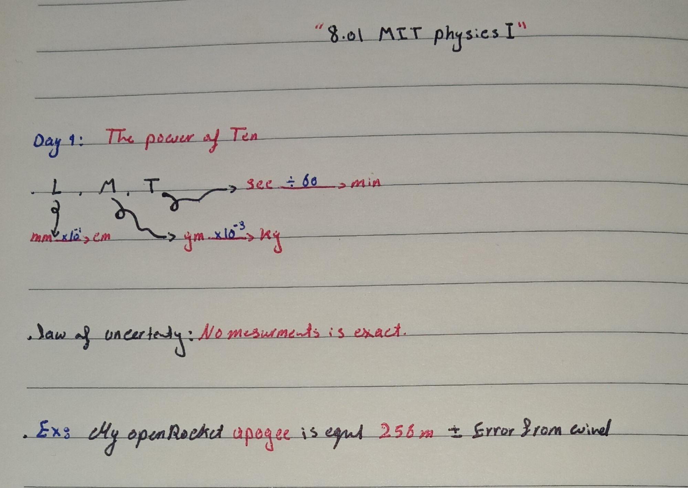

Oct 23, 2026 — MIT 8.01 Lecture 01

Today I downloaded MIT 8.01 Classical Mechanics. I started Lecture 1: The Power of Ten. Professor Lewin showed how physics works across scales from atoms to galaxies. I learned the importance of dimensional analysis and estimation, which I will use for my OpenRocket apogee calculations. I created my aerospace portfolio on GitHub to document my journey to NASA/SpaceX. Plan: 2 lectures per week.

