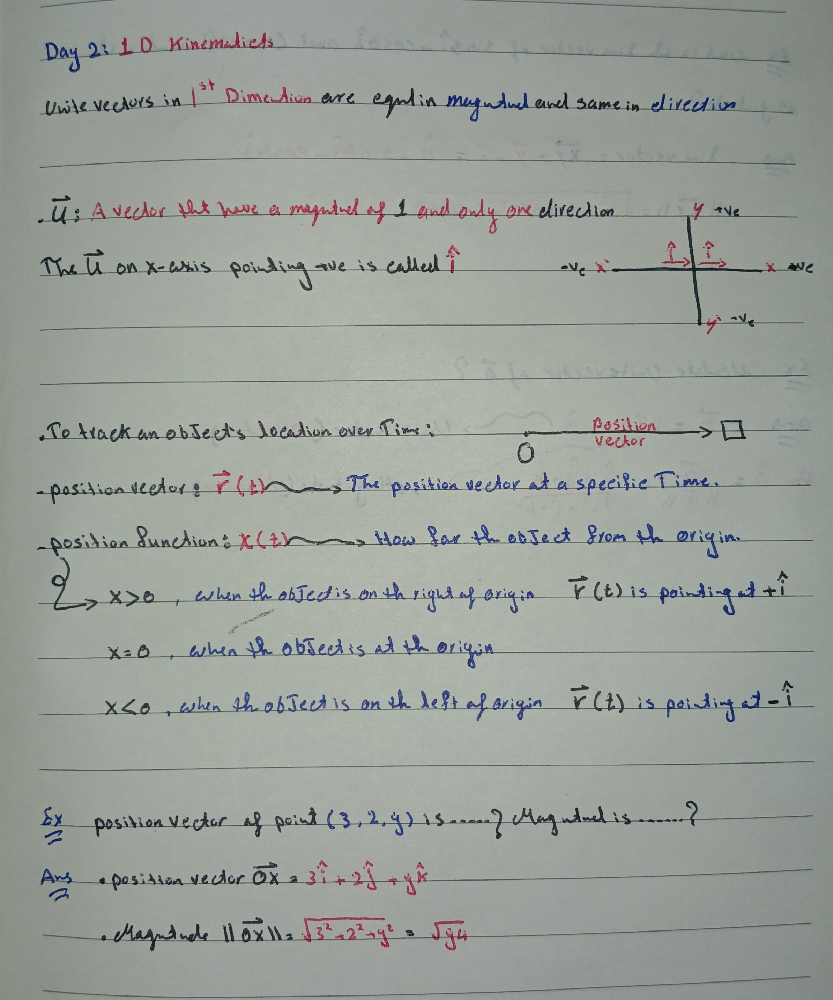

Oct 27, 2026 - MIT 8.01 Lecture 02

Today I started lecture 2: Kinematics. I learnt about vectors and the unit vectors.
And I learnt that position vectors are the position of a vector from the Origin to a specific point. And understood that the Magnitude is the HOW MUCH,
direction is WHERE. So, for example. My Rocket is 200 meters from the ground in the direction of the sky with 
the thruster force going upwards = +F_thrust y-hat and the force of its weight going down = -F_weight y-hat.

+y-hat: direction going up
-y-hat: direction going down

(Lecture02-2.png)
