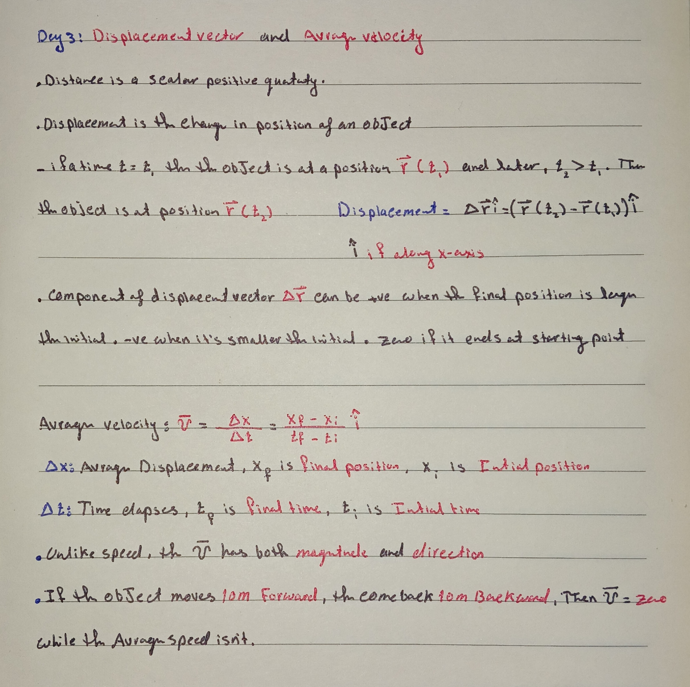

Today I studied the displacement vector and average velocity for my V4 rocket. I learned that displacement is the vector from launch to landing, so for a flight that reaches 70m and lands 20m away, the total displacement is 20m east, not the total path length. I calculated average velocity as displacement over total time, 2.5 m/s for an 8s flight, while average speed is much higher because it includes the full 140m vertical path. I understood why average velocity can be zero if the rocket returns to the pad.

