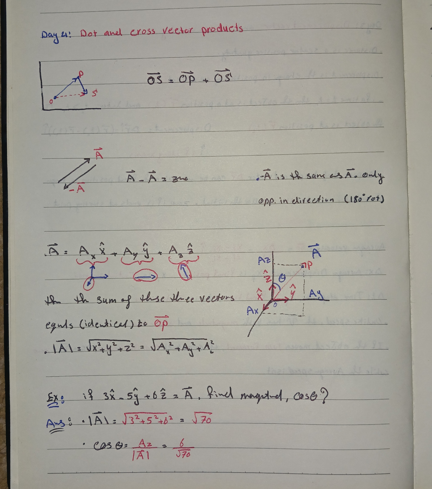
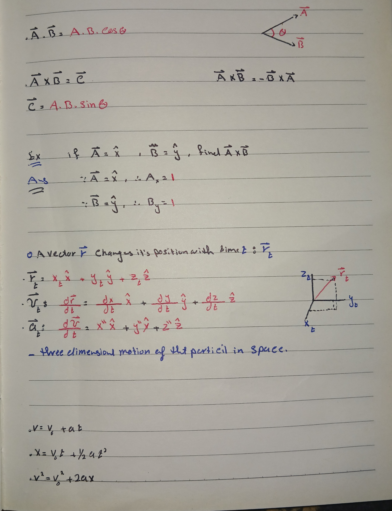

My V4 starts at rest on the pad: v0 = 0
Engine fires, it goes up.

## My Control Panel

**1. How fast?**
v = v0 + a t

**2. How high?**
x = v0 t + 1/2 a t^2

**3. How fast without time?**
v^2 = v0^2 + 2 a x

## My Example
a = 2 m/s^2, t = 5 s

v = 0 + 2 x 5 = 10 m/s
x = 0 + 1/2 x 2 x 25 = 25 m

## In My Words
3 equations = my rocket's control panel.
One for speed, one for height, one for when I lose the clock.

