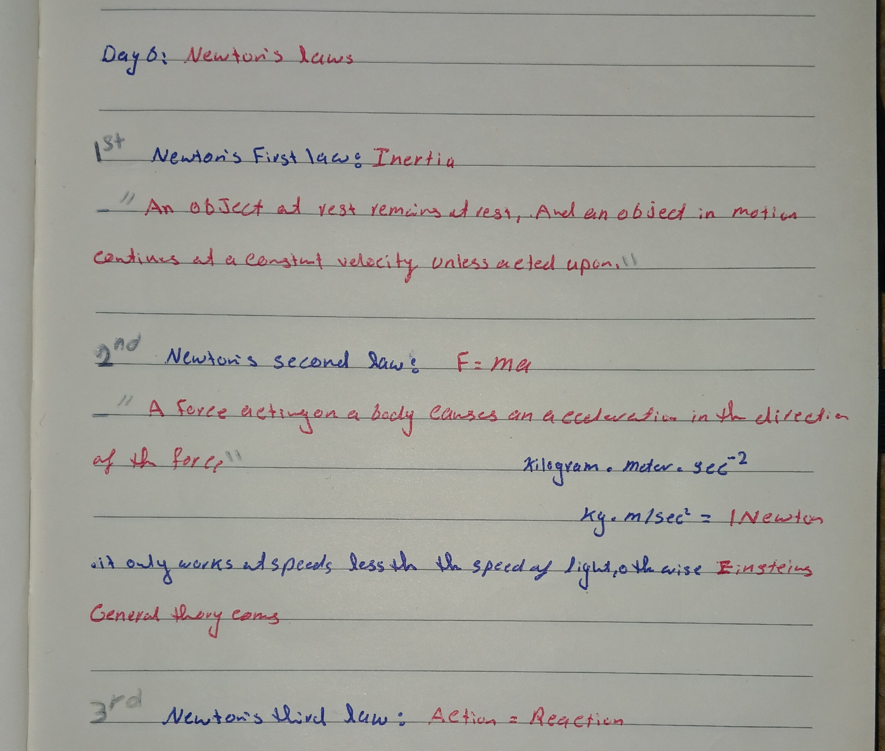

- First law: if we take all forces aside, an object with velocity in a certain direction would continue to move in this direction, and an object at rest would stay at rest. That's inertia.

- Second law: if you push with the same force, a small mass will accelerate more than a big mass. That's why F = ma; same F, small m, big a.

- Third law: just as an apple would fall towards Earth, the Earth falls towards it too. Only by a very small amount because our Earth is too big. That's action and reaction.

