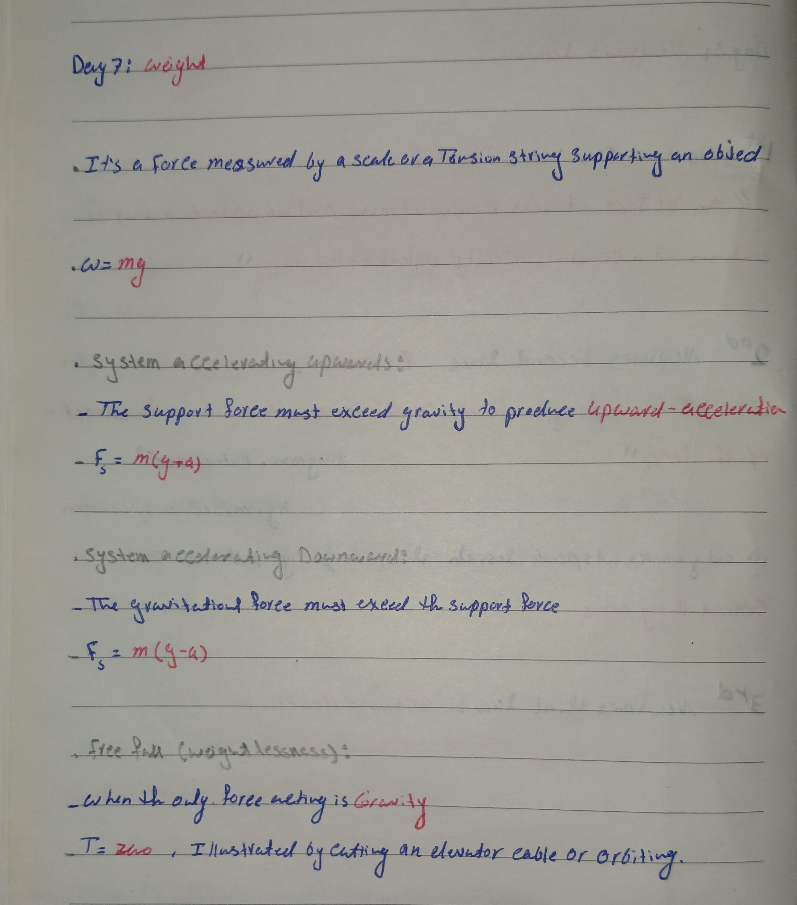

# MIT 8.01 - Lecture 7: Weight, Perceived Gravity, and Weightlessness

## 1. What is Weight?
- Weight is NOT mg
- Weight = force from scale pushing up, OR tension pulling up
- Mass is constant, weight changes with acceleration
- On Moon: g is 6x smaller, weight is 6x smaller

## 2. Elevator Accelerating UP
- g is always +9.8, signs handle direction
- Equation: Fs - mg = ma
- Result: Fs = m(a + g)
- You gain weight

## 3. Elevator Accelerating DOWN
- Equation: mg - Fs = ma
- Result: Fs = m(g - a)
- You lose weight
- If a = g (free fall): Fs = 0 -> weightless

## 5. Free Fall
- Only gravity acts on you
- No push, no pull
- Scale reads 0
- Astronauts in orbit = permanent free fall

## 6. Circular Motion Connection
- Bottom of circle: T - mg = ma -> feel heavier
- Top of circle: T + mg = ma -> if a = g, T = 0 -> weightless

