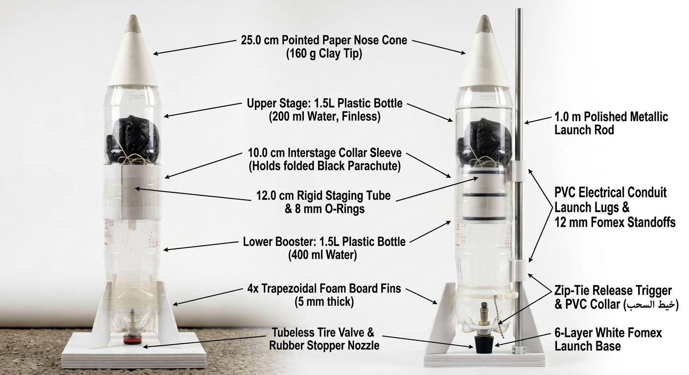

## Yesterday I bought a few things for my rocket:

- Foam Board, a 5mm sheet for my (4 fins)
- Bristol paper for my nose cone (25 cm nose cone)
- Modelling clay (nose tip weight)
- Wide clear packing tape (waterproofing)
- Hot Glue sticks (fin & collar assembly)

## This is how my two-stage water rocket should look after designing and assembling:

