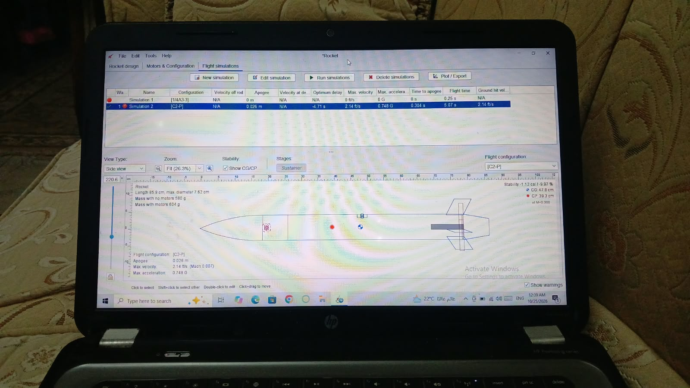
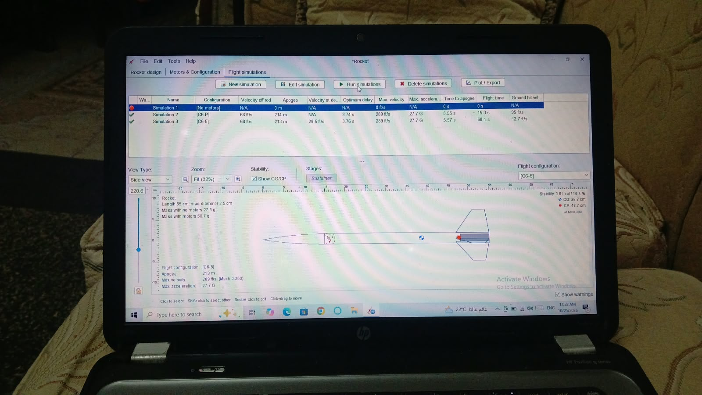

# I Taught My Rocket How To Not Crash

From 2cm to 213m in one night.

### v1: The Lawn Dart

- **Apogee:** 0.02m (my desk is taller)
- **Stability:** -1.12 cal — Red dot in front of Blue dot = instant backflip
- **Mass:** 580g with CG override wrong
- **Lesson:** CG must be in front of CP

### v2: The Missile
- **Apogee:** 214m — it flew!
- **But:** C6-P motor (P = Plugged) = no parachute
- **Ground hit:** 95 ft/s = crash
- **Lesson:** P means never pops

### v3: The One That Lands

- **Motor:** Estes C6-5 (C = 10Ns power, 6 = 6N thrust, 5 = 5s delay to pop chute)
- **Apogee:** 213m
- **Stability:** 3.61 cal (CG 38.7cm, CP 47.7cm) — a bit too stable, but safe
- **Flight time:** 68s
- **Landing speed:** 12.7 ft/s with parachute = safe
- **Velocity off rod:** 68 ft/s = beats wind

### Files in this repo
- `designs/aerospace-v3.ork` - OpenRocket design file
- `images/` - flight screenshots
- `ROCKETRY_TERMS.MD` - glossary: CG, CP, C6-5, apogee, cal explained

**Tool:** OpenRocket 22.02
**Next:** v4 with smaller fins to get stability from 3.61 to 2.0 cal

- Mohamad Ashraf, aspiring Aerospace Engineer
